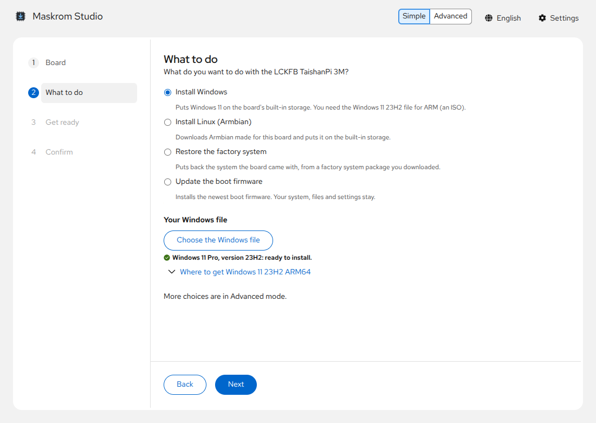
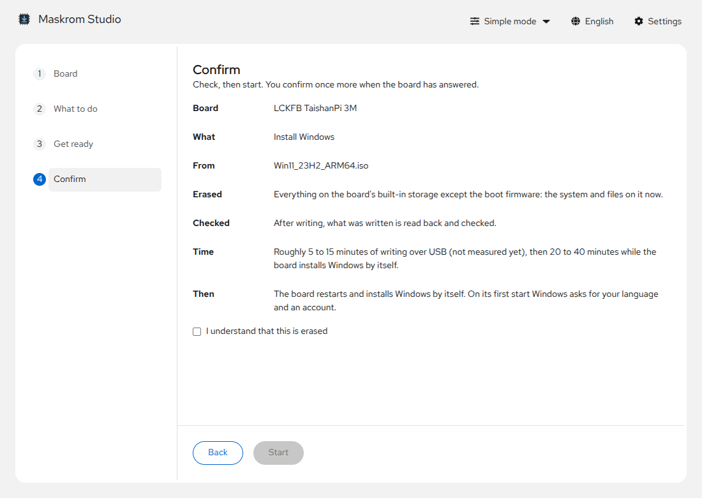
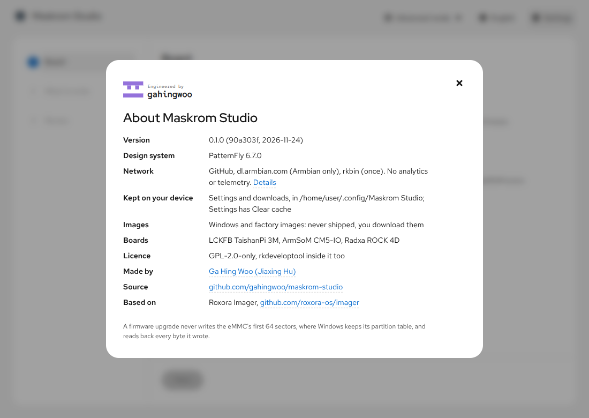

# Maskrom Studio

[简体中文](README.zh-CN.md)


Install and restore systems and UEFI firmware on Rockchip boards: a
desktop app that puts Windows 11 23H2 on the eMMC of a Rockchip RK3576
board straight from a PC over USB, with no USB stick, writes and upgrades
the boards' [edk2-rk3576](https://github.com/gahingwoo/edk2-rk3576) UEFI
firmware, and puts a board back to Armbian or a factory image.

Boards, and where Windows can go on each:

| Board | Firmware on | Windows on | MaskROM |
|---|---|---|---|
| LCKFB TaishanPi 3M | eMMC | eMMC, SD card (no M.2 slot, so no NVMe) | no button: MSK pads, or F4 in the firmware |
| ArmSoM CM5-IO | eMMC | eMMC, SD card, NVMe (M.2) | button |
| Radxa ROCK 4D | SPI NOR flash | NVMe (M.2), SD card; it has no eMMC. Windows has not started on it yet (ACPI not ready) | button |

Status: first version, not yet run on hardware. See
[docs/hardware-test.md](docs/hardware-test.md).

Two modes, switched in the masthead or in Settings.

**Simple** (the default for a new install): four steps with the
recommended choices: the board, what to do (install Windows, install
Armbian, restore the factory system, update the boot firmware), how to put
the board in flashing mode, and a confirmation that says what is erased.

| | |
|---|---|
|  Choose the board |  What to do |
|  Get ready |  Confirm |

**Advanced**: every option (firmware variants, disk layout, SD cards and
USB drives, release tiers, the WinPE stick).

| | |
|---|---|
|  What to write |  Disk layout |
|  Firmware upgrade |  About |

More, in the dark theme and in Chinese: [docs/screenshots.md](docs/screenshots.md).

## What it does

- **Windows 11 on the eMMC.** You give it a Windows 11 23H2 ARM64 ISO (or
  its install.wim or install.esd). With the board in Maskrom mode, the app
  writes [woa-rk3576](https://github.com/gahingwoo/woa-rk3576)'s WinPE and
  your Windows image into the free space of the eMMC, behind the firmware.
  The board then boots that WinPE from the eMMC, installs Windows onto the
  eMMC with DISM, adds the RK3576 drivers, deletes the staging space and
  restarts into Windows. How and why: [docs/DESIGN.md](docs/DESIGN.md).
- **Other targets.** Windows also goes onto an SD card in the PC's reader
  or an NVMe drive in a USB enclosure, which then goes into the board,
  where the board has one (table above), from Windows, Linux and macOS
  alike: the board installs it from there with DISM and adds the drivers
  (20 to 40 minutes). On a Windows PC the app can instead build the
  finished Windows itself with DISM, for these and for the eMMC (written
  over Maskrom from a virtual disk), so the board starts straight into
  Windows. On Linux and macOS the install on the board is the only method.
- **Not the whole disk, if you like.** Windows can take a chosen size (32 GB
  or more) and leave the rest unallocated, as an NTFS or exFAT data
  partition, or free at the end for Linux later; the layout is shown before
  anything is written.
- **Windows comes out configured.** The RK3576 drivers with their test
  certificate trusted, any extra driver folder you add (display, touch),
  OpenSSH server on port 22 (on by default), the clock read as UTC and
  synced over the network after every start (the boards' RTC cannot be
  trusted), and either Windows' own first-start setup or none at all: give
  a user name and password and the board starts straight to the desktop.
- **UEFI firmware.** The latest edk2-rk3576 release, written as the web
  flasher [flash.gahingwoo.com](https://flash.gahingwoo.com/) writes it
  ("whole image" or "keep the partitions"), over Maskrom.
- **Firmware upgrade that keeps Windows.** For the TaishanPi 3M and
  CM5-IO: shows the installed and the new edk2-rk3576 version, saves the
  board's UEFI settings on the PC and writes them back, never touches the
  partition table, and reads back everything it wrote.
- **On the board itself.** Run the app under Linux on the board (booted
  from an SD card or USB drive) and it writes that board's eMMC or SPI NOR
  directly, no second computer.
- **Back to Linux.** Any image Armbian publishes for the TaishanPi 3M or
  CM5-IO (Debian or Ubuntu, vendor or mainline kernel, with or without a
  desktop: GNOME, KDE Plasma, whatever Armbian's index lists), with its
  size and the space it needs, downloaded from Armbian, checked against
  its SHA-256 and Armbian's OpenPGP signature, and written over the whole
  eMMC; or a factory `update.img` you downloaded from the board maker
  (the app reads it, refuses one for another chip, and writes it as
  RKDevTool's "Upgrade Firmware" does; not yet run on a board). Both
  replace Windows and the UEFI firmware.
- **The WinPE stick.** woa-rk3576's WinPE image on a USB drive, for the
  procedure in woa-rk3576's
  [INSTALL.md](https://github.com/gahingwoo/woa-rk3576/blob/main/docs/INSTALL.md).

The app is in English and Simplified Chinese; it follows the system
language, and the switch at the top keeps your choice.

Windows 11 24H2 and later cannot run on RK3576 (ARMv8.0); images newer than
build 25999 are refused before anything is written, and so is anything not
ARM64. Windows 11 21H2 and Windows 10 (1809 and later) are allowed with a
notice: untested with the current drivers; 23H2 is the tested version. The app shows what it read from the image (architecture, build,
boot files, editions) before you choose. It does not ship or download
Windows: you download the image yourself and need a valid licence.
Microsoft's own ARM64 ISO page offers only the current release, which is
too new. Where a 23H2 ARM64 ISO can be had is listed in the app's Windows
step ([src/shared/windows-sources.json](src/shared/windows-sources.json)):
[NTriver](https://ntriver.org/download-windows-11) (works from China; the
23H2 ARM64 ISOs there are the volume licence Pro and the IoT Enterprise
media, the Consumer one is x64 only) and
[UUP dump](https://uupdump.net/known.php?q=22631+arm64), which builds the
ISO on your computer from Microsoft's update servers.

## Coming from an earlier version

On the first start, the settings, the theme and language, and the saved
UEFI settings copies are copied over from an earlier version's data
folder. Its download cache stays where it was and can be deleted. The app
id changed, so an earlier version is not updated in place: install this
one, then remove the old app (the .deb and .rpm do that themselves).

## Install

Packages for Windows (x64 and arm64), macOS and Linux (AppImage, .deb,
.rpm; x86_64 and arm64) go on the
[releases](https://github.com/gahingwoo/maskrom-studio/releases) page.
There is no tagged release yet: the pre-release tagged `ci` holds the
latest build of main, untested. On macOS, Homebrew:
`brew trust gahingwoo/tap`, then `brew install --cask
gahingwoo/tap/maskrom-studio@nightly` (the `maskrom-studio` and
`maskrom-studio@beta` casks follow tagged releases).

Release tiers, in Settings, for the app's own updates and, separately, for
the firmware and WinPE it writes: **Stable** (the newest release that is
not a pre-release), **Prerelease** (pre-releases included) and **CI** (the
rolling `ci` release of the latest successful build of main, untested).
Simple mode always writes Stable firmware. What each system asks on first start, and the
drivers for Maskrom (WinUSB through Zadig on Windows, a udev rule on Linux):
[docs/install.md](docs/install.md).

## Building

Needs Node.js 22.

```sh
npm ci
npm run writer              # the elevated writer: Node.js packed with pkg; on macOS a C helper (needs cc)
sh scripts/build-wasm.sh    # rkdeveloptool in WebAssembly; needs emsdk 3.1.48, or take the CI artifact
npm run build
npm start
```

## Tests

```sh
npm test                               # layout, GPT, FAT32, exFAT, UDF, WIM, Maskrom through the WASM against a pretend board
node scripts/electron-woa-e2e.mjs      # the staged install inside Electron against a pretend TaishanPi 3M
node scripts/electron-maskrom-e2e.mjs  # Roxora Imager's Maskrom path inside Electron
node --test test/webflash/*.test.js    # modules copied from edk2-webflash
node scripts/shots.mjs dev/shots       # screenshots, light and dark
```

The file system tests use mkfs.vfat and mtools, sfdisk and sgdisk, and
exfatprogs' fsck.exfat when they are installed (CI installs them).

## Where it comes from

A fork of [Roxora Imager](https://github.com/roxora-os/imager), keeping its
history; the `upstream` remote points there. The board list and firmware
sectors are [edk2-webflash](https://github.com/gahingwoo/edk2-webflash)'s,
copied unchanged. How it is put together and why:
[docs/DESIGN.md](docs/DESIGN.md).

## License

GPL-2.0, by Ga Hing Woo. rkdeveloptool is GPL-2.0-or-later, libusb
LGPL-2.1, etcher-sdk Apache-2.0. Rockchip's loader is not part of this
repository or of the packages; it is downloaded from rkbin when it is first
needed. Windows is not included and not downloaded.
