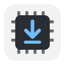
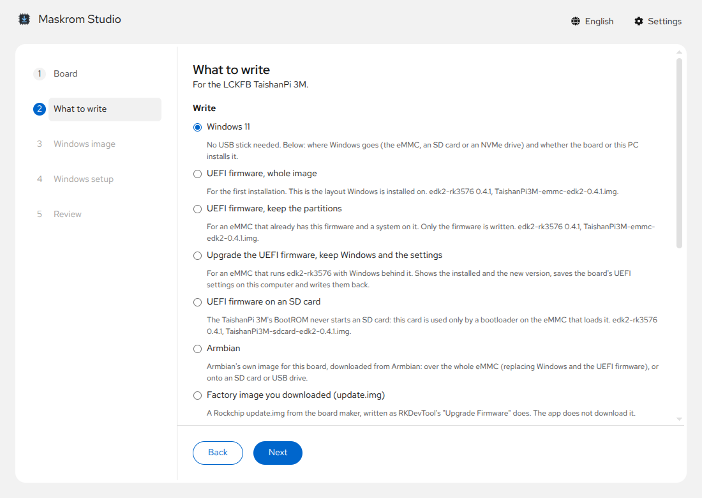

# WoA RK3576 Imager

[简体中文](README.zh-CN.md)



A desktop app that puts Windows 11 23H2 on the eMMC of a Rockchip RK3576
board straight from a PC over USB, with no USB stick, and writes the
boards' [edk2-rk3576](https://github.com/gahingwoo/edk2-rk3576) UEFI
firmware.

Boards: LCKFB TaishanPi 3M and ArmSoM CM5-IO (Windows and firmware), Radxa
ROCK 4D (firmware only; it has no eMMC).

Status: first version, not yet run on hardware. See
[docs/hardware-test.md](docs/hardware-test.md).

<p>
  
  
</p>

## What it does

- **Windows 11 on the eMMC.** You give it a Windows 11 23H2 ARM64 ISO (or
  its install.wim or install.esd). With the board in Maskrom mode, the app
  writes [woa-rk3576](https://github.com/gahingwoo/woa-rk3576)'s WinPE and
  your Windows image into the free space of the eMMC, behind the firmware.
  The board then boots that WinPE from the eMMC, installs Windows onto the
  eMMC with DISM, adds the RK3576 drivers, deletes the staging space and
  restarts into Windows. How and why: [docs/DESIGN.md](docs/DESIGN.md).
- **Other targets.** Windows also goes onto an SD card in the PC's reader
  or an NVMe drive in a USB enclosure, which then goes into the board. On
  a Windows PC the app can instead build the finished Windows itself with
  DISM, for these and for the eMMC (written over Maskrom from a virtual
  disk), so the board starts straight into Windows.
- **Windows comes out configured.** The RK3576 drivers with their test
  certificate trusted, any extra driver folder you add (display, touch),
  OpenSSH server on port 22 (on by default), the clock read as UTC and
  synced over the network after every start (the boards' RTC cannot be
  trusted), and either Windows' own first-start setup or none at all: give
  a user name and password and the board starts straight to the desktop.
- **UEFI firmware.** The latest edk2-rk3576 release, written as the web
  flasher [flash.gahingwoo.com](https://flash.gahingwoo.com/) writes it
  ("whole image" or "keep the partitions"), over Maskrom.
- **On the board itself.** Run the app under Linux on the board (booted
  from an SD card or USB drive) and it writes that board's eMMC or SPI NOR
  directly, no second computer.
- **The WinPE stick.** woa-rk3576's WinPE image on a USB drive, for the
  procedure in woa-rk3576's
  [INSTALL.md](https://github.com/gahingwoo/woa-rk3576/blob/main/docs/INSTALL.md).

The app is in English and Simplified Chinese; it follows the system
language, and the switch at the top keeps your choice.

Windows 11 24H2 and later cannot run on RK3576 (ARMv8.0); images newer than
build 25999 are refused before anything is written. The app does not
download Windows.

## Install

Packages for Windows (x64), macOS and Linux (AppImage, .deb, .rpm; x86_64
and arm64) go on the
[releases](https://github.com/gahingwoo/woa-rk3576-imager/releases) page
once there is a release. What each system asks on first start, and the
drivers for Maskrom (WinUSB through Zadig on Windows, a udev rule on Linux):
[docs/install.md](docs/install.md).

## Building

Needs Node.js 22.

```sh
npm ci
npm run writer              # the elevated writer: Node.js packed with pkg; on macOS a C helper (needs cc)
sh scripts/build-wasm.sh    # rkdeveloptool in WebAssembly; needs emsdk 3.1.48, or take the CI artifact
npm run build
npm start
```

## Tests

```sh
npm test                               # layout, GPT, FAT32, exFAT, UDF, WIM, Maskrom through the WASM against a pretend board
node scripts/electron-woa-e2e.mjs      # the staged install inside Electron against a pretend TaishanPi 3M
node scripts/electron-maskrom-e2e.mjs  # Roxora Imager's Maskrom path inside Electron
node --test test/webflash/*.test.js    # modules copied from edk2-webflash
node scripts/shots.mjs dev/shots       # screenshots, light and dark
```

The file system tests use mkfs.vfat and mtools, sfdisk and sgdisk, and
exfatprogs' fsck.exfat when they are installed (CI installs them).

## Where it comes from

A fork of [Roxora Imager](https://github.com/roxora-os/imager), keeping its
history; the `upstream` remote points there. The board list and firmware
sectors are [edk2-webflash](https://github.com/gahingwoo/edk2-webflash)'s,
copied unchanged. How it is put together and why:
[docs/DESIGN.md](docs/DESIGN.md).

## License

GPL-2.0, by Ga Hing Woo. rkdeveloptool is GPL-2.0-or-later, libusb
LGPL-2.1, etcher-sdk Apache-2.0. Rockchip's loader is not part of this
repository or of the packages; it is downloaded from rkbin when it is first
needed. Windows is not included and not downloaded.
