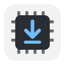
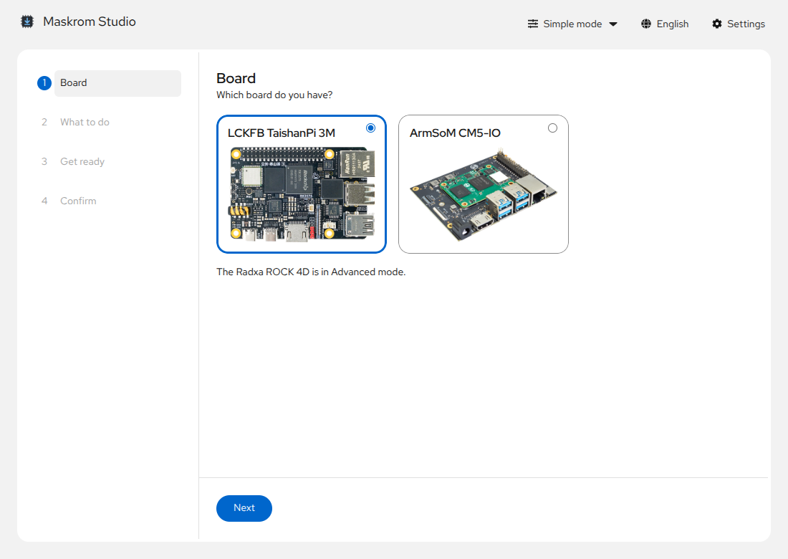
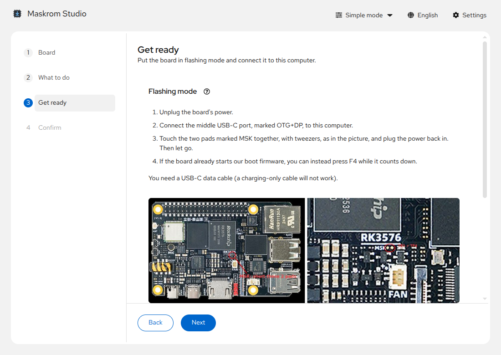
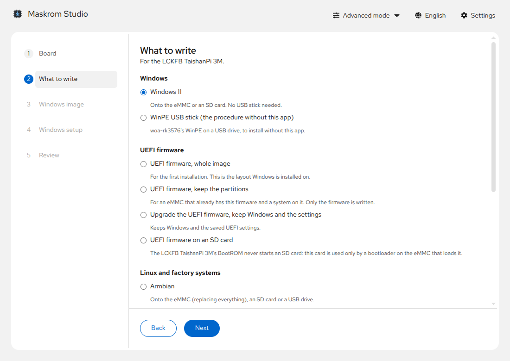
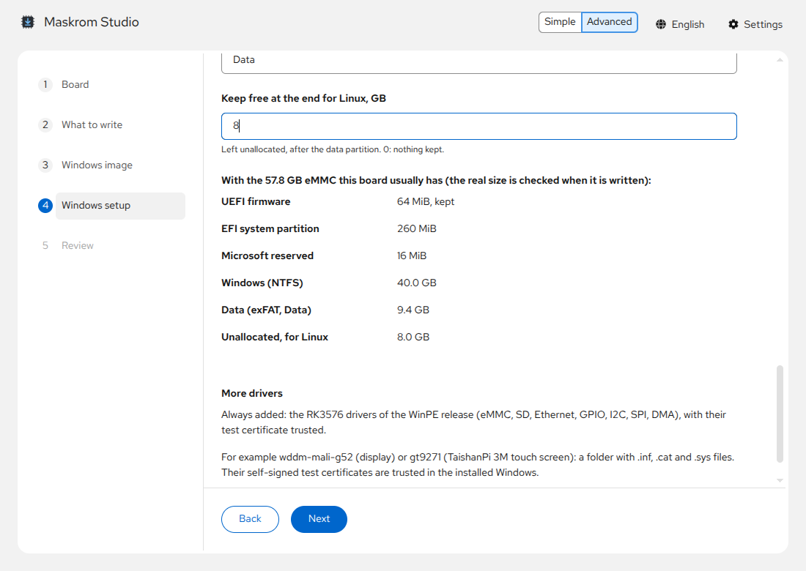
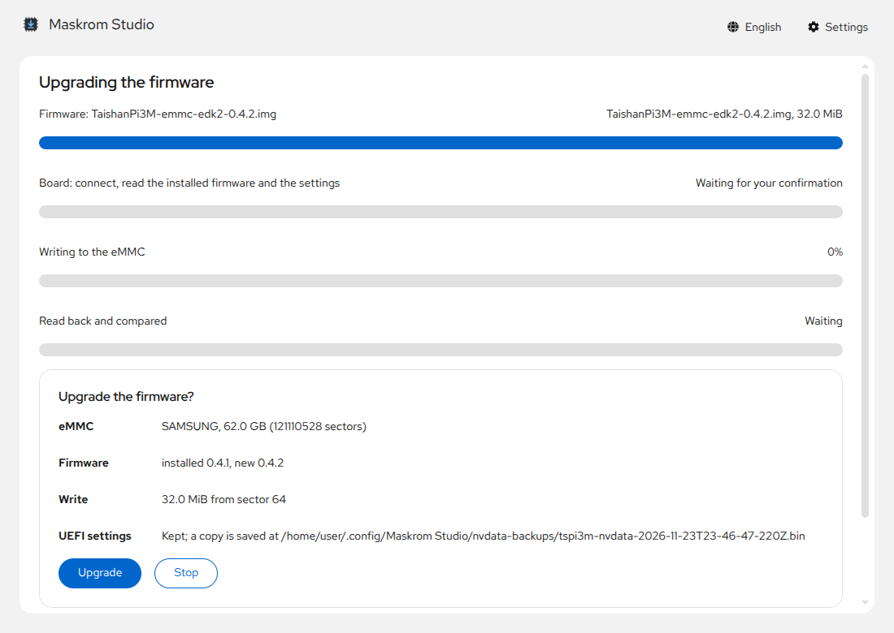

# Maskrom Studio

[简体中文](README.zh-CN.md)

A desktop app that installs and restores systems and UEFI firmware on
Rockchip RK3576 boards from a PC over USB (MaskROM mode):

- Windows 11 23H2 onto the board's eMMC, with no USB stick;
- the [edk2-rk3576](https://github.com/gahingwoo/edk2-rk3576) UEFI firmware,
  written new or upgraded with Windows and the settings kept;
- Armbian, or the board maker's factory image, to put the board back.

New to these boards? Start at
[edk2-rk3576](https://github.com/gahingwoo/edk2-rk3576#from-a-new-board-to-windows-or-linux):
its README has the whole path from a new board to Windows or Linux.

**Status, 2026-11-24:** first version, not yet run on a board. What is
still untested is listed in [docs/dev/testing.md](docs/dev/testing.md).

## Boards

| Board | Firmware on | Windows on | MaskROM |
|---|---|---|---|
| LCKFB TaishanPi 3M | eMMC | eMMC, SD card (no M.2 slot) | no button: short the MSK pads, or F4 in the firmware |
| ArmSoM CM5-IO | eMMC | eMMC, SD card, NVMe (M.2) | button |
| Radxa ROCK 4D | SPI NOR flash | NVMe (M.2), SD card; no eMMC. Windows does not start on it yet (its firmware has no ACPI tables) | button |

## Two modes

**Simple** (the default): four steps with the recommended choices. Choose
the board, choose what to do (install Windows, install Armbian, update the
boot firmware), put the board in flashing mode as shown, and confirm what is
erased. Restoring the factory system is in Advanced mode only until it has
been run on a board.

| | |
|---|---|
|  Choose the board |  What to do |
|  Get ready |  Confirm |

**Advanced**: every option: firmware variants, the disk layout, SD cards and
USB drives, release tiers, the WinPE stick.

| | |
|---|---|
|  What to write |  Disk layout |
|  Firmware upgrade |  About |

More screenshots, in the dark theme and in Chinese:
[docs/screenshots.md](docs/screenshots.md).

## What it does

- **Windows 11 on the eMMC.** Give it a Windows 11 23H2 ARM64 ISO (or its
  install.wim or install.esd). Over MaskROM it writes
  [woa-rk3576](https://github.com/gahingwoo/woa-rk3576)'s WinPE and your
  image into the free space of the eMMC; the board then installs Windows
  itself with the RK3576 drivers and restarts into it (20 to 40 minutes).
- **Other targets.** An SD card in the PC's reader, or an NVMe drive in a USB
  enclosure, which then goes into the board. On a Windows PC the app can
  also build the finished Windows itself with DISM.
- **Windows comes out configured.** The drivers and their test certificate
  trusted, extra driver folders you add, OpenSSH on port 22, the clock read
  as UTC and synced after every start, first-start setup kept or skipped,
  optional trimming of background apps, and the RK3576 tools (monitor
  widget, NPU tools) when the WinPE release carries them.
- **Not the whole disk, if you like.** Windows can take a chosen size (32 GB
  or more), with the rest as a data partition or left free for Linux.
- **UEFI firmware.** The latest edk2-rk3576 release, written as
  [flash.gahingwoo.com](https://flash.gahingwoo.com/) writes it ("whole
  image" or "keep the partitions"), or upgraded with Windows and the UEFI
  settings kept and everything read back.
- **Back to Linux.** Any Armbian image for the TaishanPi 3M or the CM5-IO,
  checked against its SHA-256 and Armbian's signature, or a factory
  `update.img` (not yet run on a board).
- **On the board itself.** Run under Linux on the board, it writes that
  board's eMMC or SPI NOR without a second computer.
- **The WinPE stick.** woa-rk3576's WinPE on a USB drive, for its
  [install guide](https://github.com/gahingwoo/woa-rk3576/blob/main/docs/INSTALL.md).

Windows 11 24H2 and later cannot run on RK3576 (ARMv8.0), so newer images
are refused. The app does not ship or download Windows: you bring the image
and a licence.

How to use each of these, step by step: [docs/use.md](docs/use.md).

The app is in English and Simplified Chinese. It follows the system
language; the switch at the top keeps your choice.

## Install

Packages for Windows (x64, arm64), macOS and Linux (AppImage, .deb, .rpm;
x86_64 and arm64) are on the
[releases](https://github.com/gahingwoo/maskrom-studio/releases) page. There
is no tagged release yet: the pre-release tagged `ci` holds the latest
build of main, untested. On macOS: `brew trust gahingwoo/tap`, then
`brew install --cask gahingwoo/tap/maskrom-studio@nightly`.

Each system's first-start warning, the MaskROM driver (WinUSB through Zadig
on Windows, a udev rule on Linux), release tiers and updates:
[docs/install.md](docs/install.md). What the app contacts and keeps:
[docs/network.md](docs/network.md).

## For developers

- [Building and tests](docs/dev/building.md)
- [Design](docs/dev/design.md): how it works and why
- [Testing](docs/dev/testing.md): what has and has not run on a board, and
  the [board session procedure](docs/dev/hardware-test.md)
- [Releasing](docs/dev/release.md)
- [History](docs/history/README.md)

A fork of [Roxora Imager](https://github.com/roxora-os/imager), keeping its
history; the `upstream` remote points there. The board list and firmware
sectors are [edk2-webflash](https://github.com/gahingwoo/edk2-webflash)'s,
copied unchanged.

## License

GPL-2.0, by Ga Hing Woo. rkdeveloptool is GPL-2.0-or-later, libusb
LGPL-2.1, etcher-sdk Apache-2.0. Rockchip's loader is not part of this
repository or of the packages; it is downloaded from rkbin when it is first
needed. Windows is not included and not downloaded.
