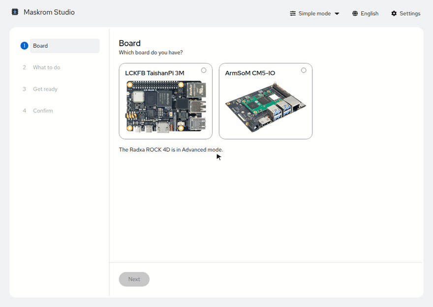

# Maskrom Studio

[简体中文](README.zh-CN.md)

A desktop app that installs Windows 11 23H2 or Windows 10 22H2, the
[edk2-rk3576](https://github.com/gahingwoo/edk2-rk3576) UEFI firmware,
Armbian or a factory image on Rockchip RK3576 boards from a PC over USB
(MaskROM mode). No USB stick is needed for Windows.

New to these boards? The
[edk2-rk3576 README](https://github.com/gahingwoo/edk2-rk3576#from-a-new-board-to-windows-or-linux)
has the whole path from a new board to Windows or Linux.

## Boards

<!-- generated:boards -->

| Board | Firmware on | Windows on | MaskROM | Windows and Armbian |
|---|---|---|---|---|
| LCKFB TaishanPi 3M | eMMC | eMMC, SD card | short the MSK pads, or F4 in the firmware | both on the eMMC (Advanced mode) |
| ArmSoM CM5-IO | eMMC | eMMC, SD card, NVMe | button | Windows on the eMMC or NVMe, Armbian on an SD card (Advanced mode) |
| Radxa ROCK 4D | SPI NOR | NVMe, SD card | button | Windows on NVMe, Armbian on an SD card (Advanced mode) |

<!-- /generated -->

Generated from `src/woa/boards.ts` by `scripts/gen-docs`. Windows on the
ROCK 4D needs [edk2-rk3576 0.5.0](https://github.com/gahingwoo/edk2-rk3576/releases/tag/0.5.0) or later.

## Status

Board-tested on 2026-11-26: Windows onto an NVMe drive for the ROCK 4D,
end to end (install, desktop, drivers, Ethernet). Everything else has run
only in CI, against a pretend board. Board checks still to do:
[docs/dev/testing.md](docs/dev/testing.md).

| Feature | Status |
|---|---|
| Windows onto the eMMC over MaskROM (the board installs it from a staged WinPE) | CI only |
| Windows onto an NVMe drive in the PC | board-tested (ROCK 4D) |
| Windows onto an SD card in the PC | CI only |
| Windows built on a Windows PC with DISM | CI only |
| Windows and Armbian on one eMMC (TaishanPi 3M, Advanced mode) | off by default |
| ROCK 4D: Windows on NVMe and Armbian on an SD card (Advanced mode) | CI only |
| Windows trimming, recommended set | CI only |
| Browser switch cleanup (an older tools bundle's `--disable-direct-composition` taken out) | CI only |
| Self-test on Windows' first desktop | CI only |
| Automatic sign-in on every start | off by default |
| UEFI firmware: whole image, keep the partitions | CI only |
| UEFI firmware upgrade keeping Windows and the settings | CI only |
| ROCK 4D: UEFI firmware to the SPI NOR, whole or keeping the settings | CI only |
| Armbian onto the eMMC, an SD card or a USB drive | CI only |
| Factory `update.img` (Advanced mode) | CI only |
| Writing the board from Linux running on it | CI only |
| WinPE USB stick | CI only |

Windows 11 24H2 and later cannot run on RK3576 (ARMv8.0) and are refused.
The app does not ship or download Windows: you bring the image and a
licence.

## Install

Packages for Windows, macOS and Linux are on the
[releases](https://github.com/gahingwoo/maskrom-studio/releases) page (the
pre-release tagged `ci` is the latest untested build of main). Per system,
including the MaskROM driver: [docs/install.md](docs/install.md).

## Documentation

- [Using the app](docs/use.md), step by step
- [Getting a Windows 11 23H2 ARM64 image](docs/windows-image.md)
- [What the app contacts and keeps](docs/network.md)
- [Screenshots](docs/screenshots.md)
- Developers: [building](docs/dev/building.md), [design](docs/dev/design.md),
  [Windows + Armbian design](docs/dev/hybrid-and-presets.md),
  [testing](docs/dev/testing.md), [board session](docs/dev/hardware-test.md),
  [releasing](docs/dev/release.md), [history](docs/history/README.md)

A fork of [Roxora Imager](https://github.com/roxora-os/imager), keeping its
history; the `upstream` remote points there. The board list and firmware
sectors are [edk2-webflash](https://github.com/gahingwoo/edk2-webflash)'s,
copied unchanged.

## License

GPL-2.0, by Ga Hing Woo. rkdeveloptool is GPL-2.0-or-later, libusb
LGPL-2.1, etcher-sdk Apache-2.0. Rockchip's loader is not in this
repository or the packages; it is downloaded from rkbin when first needed.
