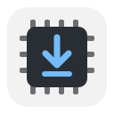
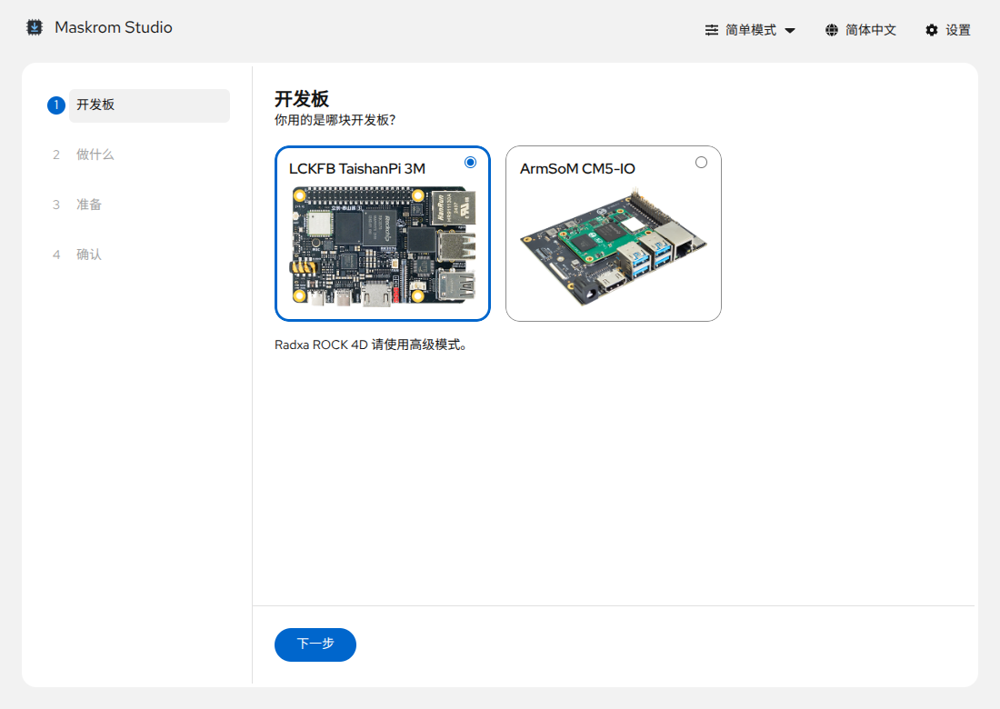
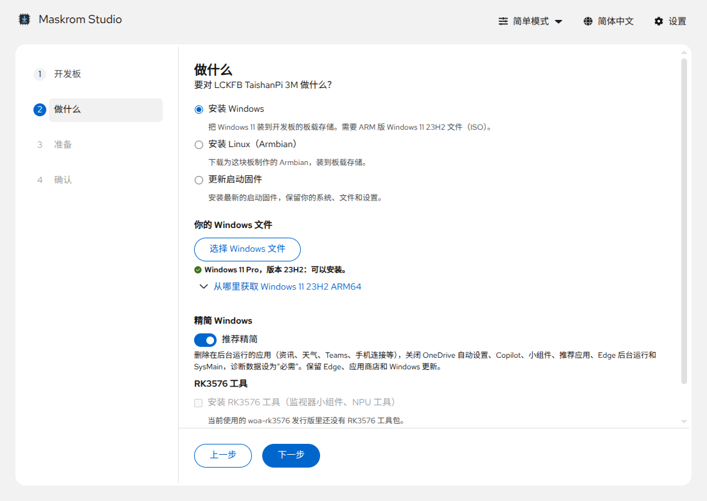
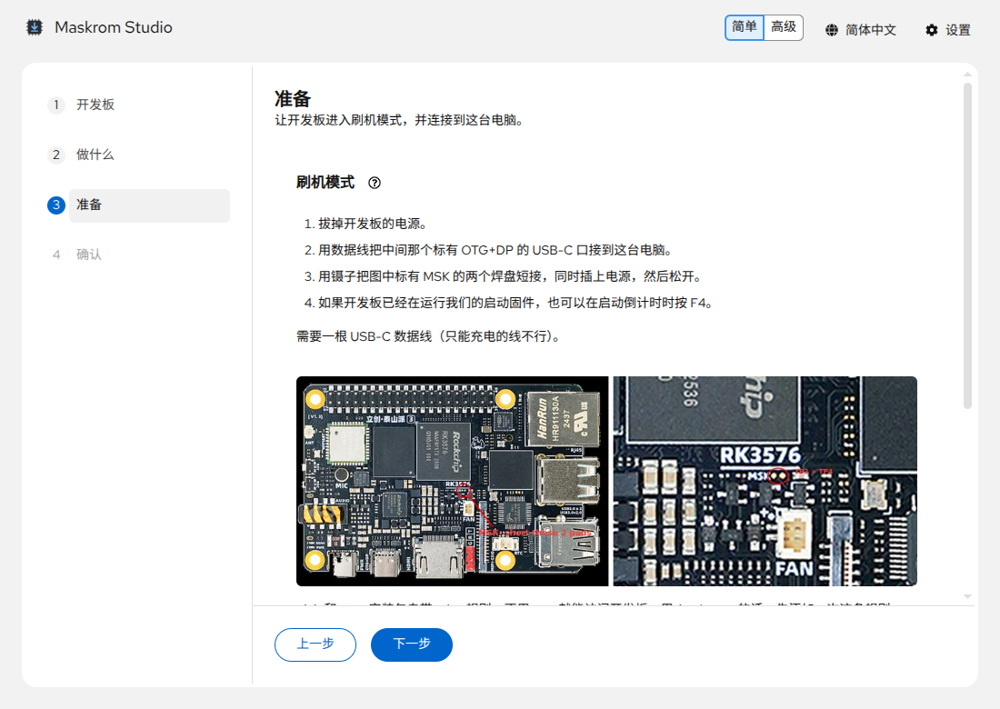
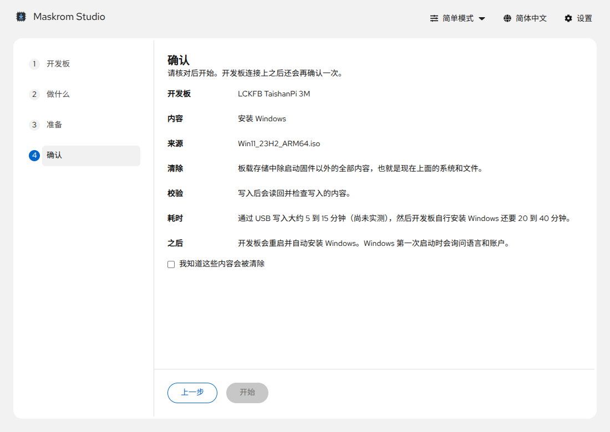
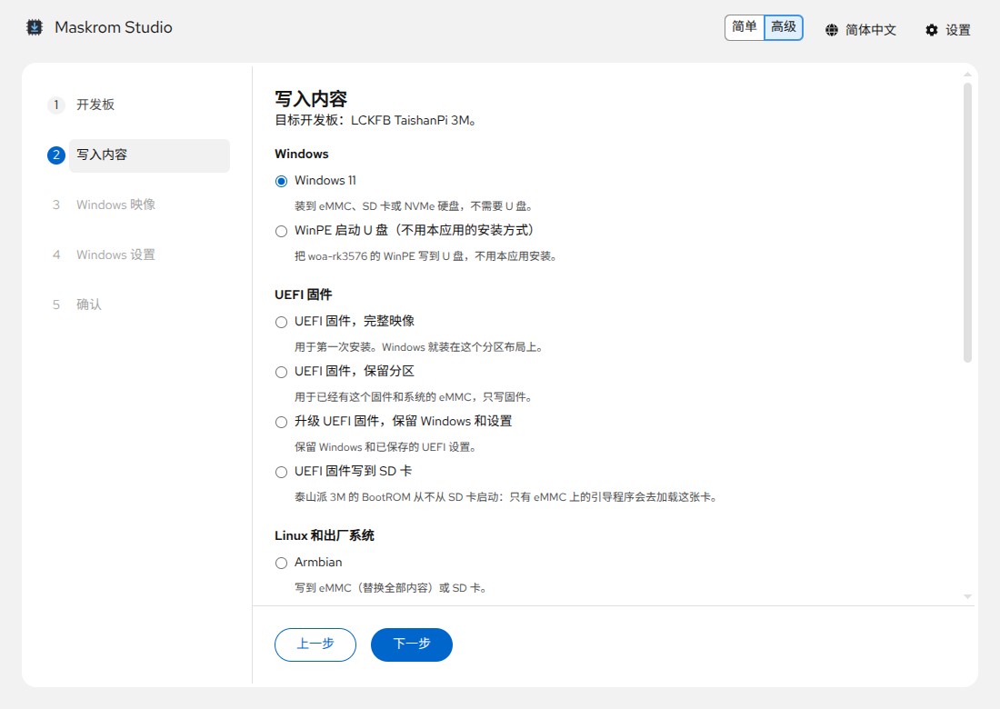
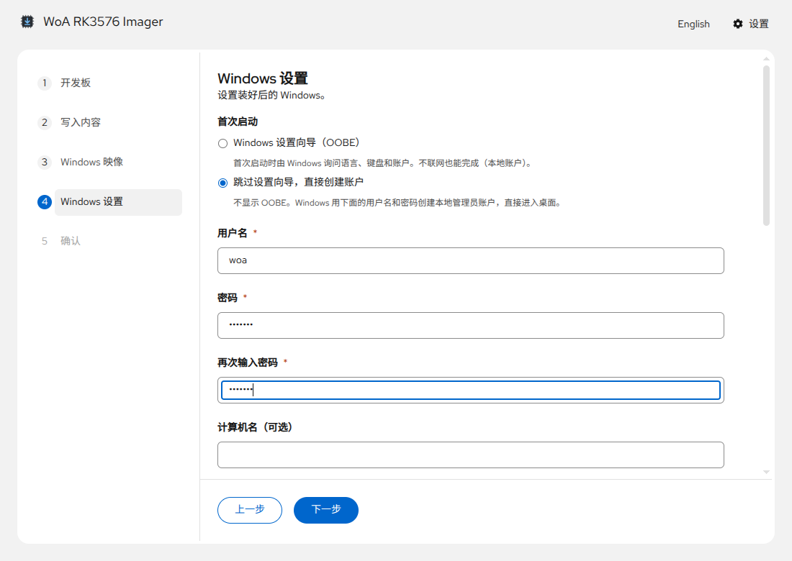
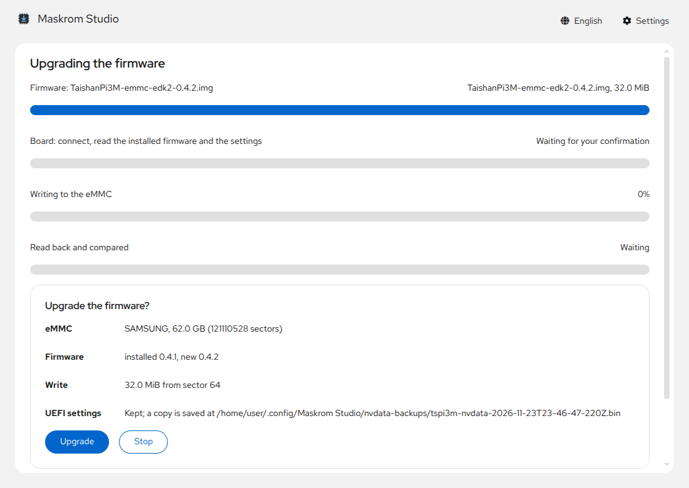
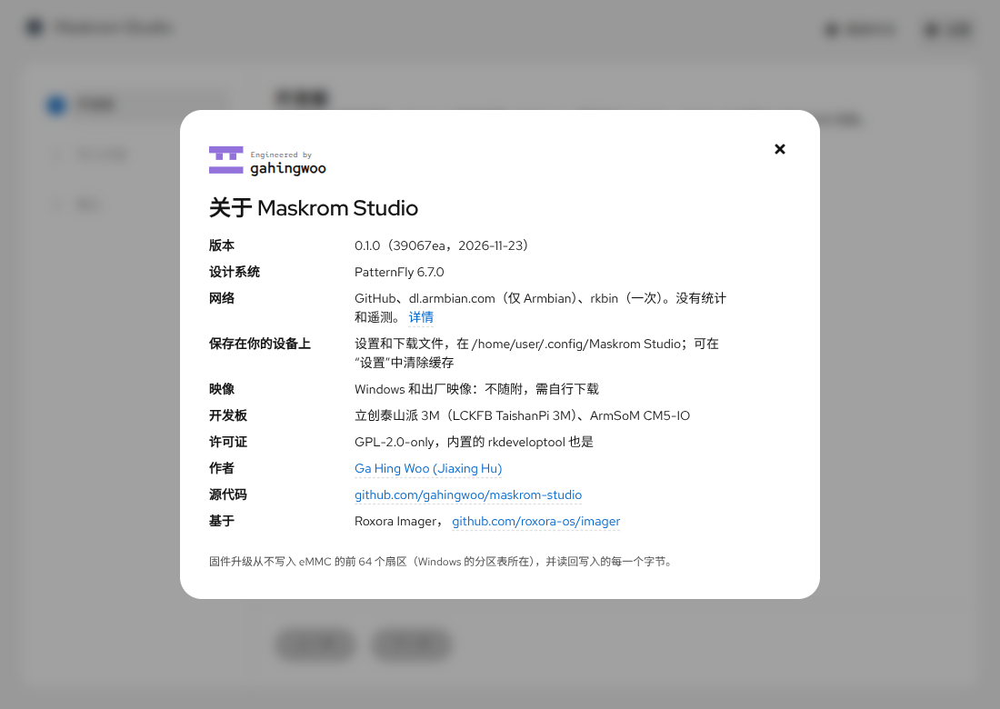

# Maskrom Studio

[English](README.md)（本页与英文版内容一致，2026-11-24）

一个桌面应用：在电脑上通过 USB（MaskROM 模式），给 Rockchip RK3576 开发板安装、恢复系统和 UEFI 固件：

- 把 Windows 11 23H2 装到开发板的 eMMC 上，不需要 U 盘；
- 写入 [edk2-rk3576](https://github.com/gahingwoo/edk2-rk3576) UEFI 固件，或在保留 Windows 和设置的前提下升级固件；
- 写入 Armbian 或开发板厂商的出厂映像，把开发板恢复回去。

第一次接触这些板子？请从 [edk2-rk3576](https://github.com/gahingwoo/edk2-rk3576/blob/main/README.zh-CN.md) 开始：它的说明里有从新板子到 Windows 或 Linux 的完整路径。

**现状（2026-11-24）：** 第一个版本，还没有在实际开发板上跑过。尚未测试的项目列在 [docs/dev/testing.md](docs/dev/testing.md)（英文）。

## 开发板

| 开发板 | 固件位置 | Windows 可装到 | MaskROM |
|---|---|---|---|
| 立创泰山派 3M（LCKFB TaishanPi 3M） | eMMC | eMMC、SD 卡（没有 M.2 插槽） | 没有按键：短接 MSK 焊盘，或在固件中按 F4 |
| ArmSoM CM5-IO | eMMC | eMMC、SD 卡、NVMe（M.2） | 有按键 |
| Radxa ROCK 4D | SPI NOR 闪存 | NVMe（M.2）、SD 卡；没有 eMMC。Windows 暂时还不能在这块板上启动（它的固件没有 ACPI 表） | 有按键 |

## 两种模式

**简单模式**（默认）：四个步骤，全部使用推荐设置。选开发板，选要做什么（安装 Windows、安装 Armbian、更新启动固件），按说明让开发板进入刷机模式，最后确认会清除哪些内容。恢复出厂系统在板上跑过之前只放在高级模式里。

| | |
|---|---|
|  选开发板 |  做什么 |
|  准备 |  确认 |

**高级模式**：全部选项：固件的各种写法、磁盘布局、SD 卡和 U 盘、发布类型、WinPE 启动 U 盘。

| | |
|---|---|
|  写入内容 |  磁盘布局 |
|  固件升级 |  关于 |

更多截图（含深色主题和中文界面）：[docs/screenshots.md](docs/screenshots.md)。

## 能做什么

- **把 Windows 11 装到 eMMC。** 提供一个 Windows 11 23H2 ARM64 ISO（或其中的 install.wim / install.esd）。应用通过 MaskROM 把 [woa-rk3576](https://github.com/gahingwoo/woa-rk3576) 的 WinPE 和你的映像写进 eMMC 的空闲空间；开发板随后自己装好 Windows 和 RK3576 驱动，再重启进入 Windows（20 到 40 分钟）。
- **其他安装位置。** 插在电脑读卡器里的 SD 卡，或装在 USB 硬盘盒里的 NVMe 硬盘，写好后再装到开发板上。在 Windows 电脑上，应用还可以直接用 DISM 生成装好的 Windows。
- **装好的 Windows 直接可用。** 自带驱动并信任其测试证书，可以加入你自己的驱动文件夹，OpenSSH 监听 22 端口，按 UTC 读取时钟并在每次开机后校时，首次启动向导可以保留或跳过，可以精简后台应用，发行版带有 RK3576 工具（监视小组件、NPU 工具）时一并安装。
- **不一定占满整个磁盘。** Windows 可以只用设定的大小（至少 32 GB），其余空间建成数据分区，或留给以后装 Linux。
- **UEFI 固件。** 从 edk2-rk3576 最新发行版取固件，按 [flash.gahingwoo.com](https://flash.gahingwoo.com/) 相同的方式写入（"完整映像"或"保留分区"）；也可以升级固件，保留 Windows 和 UEFI 设置，并把写入的内容全部读回比较。
- **回到 Linux。** 泰山派 3M 或 CM5-IO 的任意 Armbian 映像，用 SHA-256 和 Armbian 的签名校验；或者出厂 `update.img`（尚未在开发板上跑过）。
- **在开发板上直接运行。** 在开发板上的 Linux 里运行，直接写入本机的 eMMC 或 SPI NOR，不需要第二台电脑。
- **WinPE 启动 U 盘。** 把 woa-rk3576 的 WinPE 写到 U 盘，按它的[安装说明](https://github.com/gahingwoo/woa-rk3576/blob/main/docs/INSTALL.zh-CN.md)使用。

RK3576 是 ARMv8.0，跑不了 Windows 11 24H2 及更新版本，这些映像会被拒绝。应用不提供也不下载 Windows：映像和许可证需要你自己准备。

每一项的具体步骤：[docs/zh-CN/use.md](docs/zh-CN/use.md)。

界面有英文和简体中文，默认跟随系统语言，顶部的切换会记住你的选择。

## 安装

Windows（x64、arm64）、macOS 和 Linux（AppImage、.deb、.rpm；x86_64 和 arm64）的安装包放在 [Releases](https://github.com/gahingwoo/maskrom-studio/releases) 页面。目前还没有正式版：标签为 `ci` 的预发布版是 main 最新的构建，未经测试。macOS 上：先 `brew trust gahingwoo/tap`，再 `brew install --cask gahingwoo/tap/maskrom-studio@nightly`。

各系统首次运行时的提示、MaskROM 驱动（Windows 上用 Zadig 装 WinUSB，Linux 上加 udev 规则）、发布类型和更新：[docs/zh-CN/install.md](docs/zh-CN/install.md)。应用会访问哪些网站、保存什么：[docs/network.md](docs/network.md)（英文）。

## 开发文档（英文）

- [编译和测试](docs/dev/building.md)
- [设计](docs/dev/design.md)：怎么工作、为什么这样做
- [测试](docs/dev/testing.md)：哪些在开发板上跑过、哪些还没有，以及[板上测试步骤](docs/dev/hardware-test.md)
- [发布](docs/dev/release.md)
- [历史记录](docs/history/README.md)

本项目派生自 [Roxora Imager](https://github.com/roxora-os/imager)，保留了它的提交历史；`upstream` 远端指向它。开发板列表和固件扇区取自 [edk2-webflash](https://github.com/gahingwoo/edk2-webflash)，原样复制。

## 许可证

GPL-2.0，作者 Ga Hing Woo。rkdeveloptool 是 GPL-2.0-or-later，libusb 是 LGPL-2.1，etcher-sdk 是 Apache-2.0。本仓库和安装包都不包含 Rockchip 的 loader，首次需要时从 rkbin 下载。不包含、也不下载 Windows。
