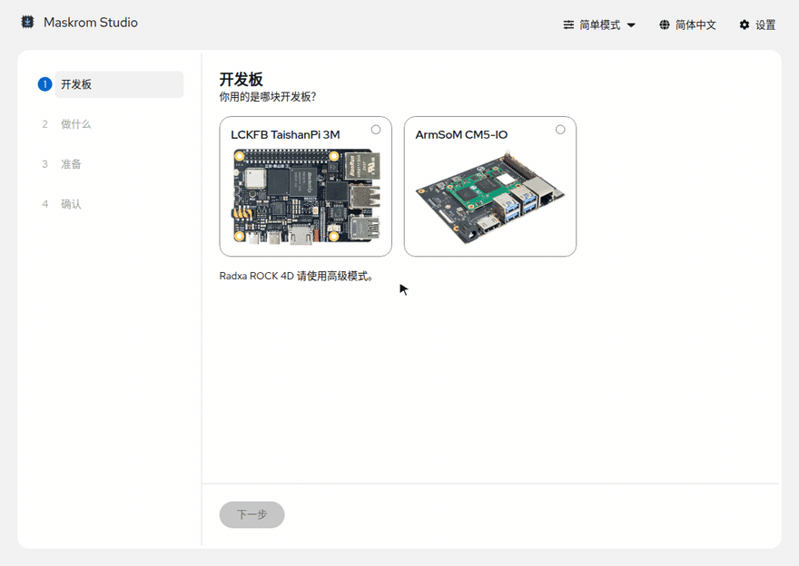

# Maskrom Studio

[English](README.md)

一个桌面应用：在电脑上通过 USB（MaskROM 模式）给 Rockchip RK3576 开发板安装 Windows 11 23H2、[edk2-rk3576](https://github.com/gahingwoo/edk2-rk3576) UEFI 固件、Armbian 或出厂映像。装 Windows 不需要 U 盘。

第一次接触这些板子？[edk2-rk3576 的说明](https://github.com/gahingwoo/edk2-rk3576/blob/main/README.zh-CN.md)里有从新板子到 Windows 或 Linux 的完整路径。

## 开发板

<!-- generated:boards -->

| 开发板 | 固件位置 | Windows 装到 | MaskROM | Windows 和 Armbian 同时装 |
|---|---|---|---|---|
| 立创泰山派 3M | eMMC | eMMC、SD 卡 | 短接 MSK 焊盘，或在固件里按 F4 | 都装在 eMMC 上 |
| ArmSoM CM5-IO | eMMC | eMMC、SD 卡、NVMe | 按键 | 都装在一块 NVMe 硬盘上；或 Windows 在 eMMC 或 NVMe，Armbian 在 SD 卡（高级模式） |
| Radxa ROCK 4D | SPI NOR | NVMe、SD 卡 | 按键 | Windows 在 NVMe，Armbian 在 SD 卡（高级模式） |

<!-- /generated -->

由 `scripts/gen-docs` 根据 `src/woa/boards.ts` 生成。ROCK 4D 上的 Windows 需要 [edk2-rk3576 0.5.0](https://github.com/gahingwoo/edk2-rk3576/releases/tag/0.5.0) 或更新。

## 现状

2026-11-26 上板测试通过：为 ROCK 4D 把 Windows 写到 NVMe 硬盘，全程（安装、桌面、驱动、以太网）。其余功能只在 CI 里用模拟开发板跑过。还要上板检查的项目见 [docs/dev/testing.md](docs/dev/testing.md)（英文）。

| 功能 | 状态 |
|---|---|
| 通过 MaskROM 把 Windows 装到 eMMC（开发板从暂存的 WinPE 自行安装） | 仅 CI |
| 把 Windows 写到电脑上的 NVMe 硬盘 | 上板测试通过（ROCK 4D） |
| 把 Windows 写到电脑上的 SD 卡 | 仅 CI |
| 在 Windows 电脑上用 DISM 生成 Windows | 仅 CI |
| 同一块 eMMC 上装 Windows 和 Armbian（泰山派 3M，高级模式） | 默认关闭 |
| ROCK 4D：Windows 装到 NVMe，Armbian 写到 SD 卡（高级模式） | 仅 CI |
| CM5-IO：Windows 和 Armbian 装到同一块 NVMe 硬盘（“Windows + Armbian”，实验性） | 仅 CI |
| 精简 Windows（推荐组合） | 仅 CI |
| 浏览器开关清理（去掉旧版工具包加上的 `--disable-direct-composition`） | 仅 CI |
| Windows 第一次进桌面时的自检 | 仅 CI |
| 每次开机自动登录 | 默认关闭 |
| UEFI 固件：完整映像、保留分区 | 仅 CI |
| 保留 Windows 和设置的固件升级 | 仅 CI |
| ROCK 4D：把 UEFI 固件写到 SPI NOR，整个写入或保留设置 | 仅 CI |
| Armbian 写到 eMMC、SD 卡或 U 盘 | 仅 CI |
| 出厂 `update.img`（高级模式） | 仅 CI |
| 在开发板上的 Linux 里直接写入本机 | 仅 CI |
| WinPE 启动 U 盘 | 仅 CI |

RK3576 是 ARMv8.0，跑不了 Windows 11 24H2 及更新版本，这些映像会被拒绝。应用不提供也不下载 Windows：映像和许可证需要你自己准备。

## 安装

Windows、macOS 和 Linux 的安装包在 [Releases](https://github.com/gahingwoo/maskrom-studio/releases) 页面（标签为 `ci` 的预发布版是 main 最新的构建，未经测试）。各系统的安装方法和 MaskROM 驱动：[docs/zh-CN/install.md](docs/zh-CN/install.md)。

## 文档

- [使用说明](docs/zh-CN/use.md)
- [获取 Windows 11 23H2 ARM64 映像](docs/zh-CN/windows-image.md)
- [应用访问哪些网站、保存什么](docs/network.md)（英文）
- [截图](docs/screenshots.md)
- 开发文档（英文）：[编译](docs/dev/building.md)、[设计](docs/dev/design.md)、[Windows + Armbian 设计](docs/dev/hybrid-and-presets.md)、[测试](docs/dev/testing.md)、[上板测试步骤](docs/dev/hardware-test.md)、[发布](docs/dev/release.md)、[历史记录](docs/history/README.md)

本项目派生自 [Roxora Imager](https://github.com/roxora-os/imager)，保留了它的提交历史；`upstream` 远端指向它。开发板列表和固件扇区取自 [edk2-webflash](https://github.com/gahingwoo/edk2-webflash)，原样复制。

## 许可证

GPL-2.0，作者 Ga Hing Woo。rkdeveloptool 是 GPL-2.0-or-later，libusb 是 LGPL-2.1，etcher-sdk 是 Apache-2.0。本仓库和安装包都不包含 Rockchip 的 loader，首次需要时从 rkbin 下载。
