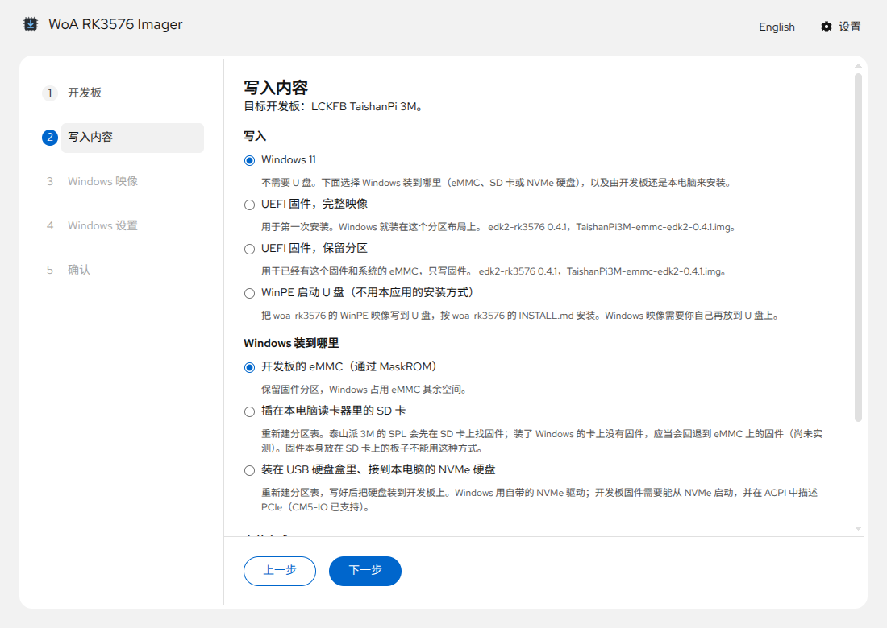

# WoA RK3576 Imager

[English](README.md)

一个桌面应用：在电脑上通过 USB，把 Windows 11 23H2 直接装到 Rockchip RK3576 开发板的 eMMC 上，不需要 U 盘；也可以写入开发板的 [edk2-rk3576](https://github.com/gahingwoo/edk2-rk3576) UEFI 固件。

支持的开发板：立创泰山派 3M（LCKFB TaishanPi 3M）和 ArmSoM CM5-IO（Windows 和固件），Radxa ROCK 4D（只有固件，它没有 eMMC）。

现状：第一个版本，还没有在实际开发板上跑过。测试步骤见 [docs/hardware-test.md](docs/hardware-test.md)（英文）。

  
  

## 能做什么

- **把 Windows 11 装到 eMMC。** 你提供一个 Windows 11 23H2 ARM64 的 ISO（或其中的 install.wim / install.esd）。开发板进入 MaskROM 模式后，应用把 [woa-rk3576](https://github.com/gahingwoo/woa-rk3576) 的 WinPE 和你的 Windows 映像写进 eMMC 上固件之后的空闲空间。开发板随后从 eMMC 启动这个 WinPE，用 DISM 把 Windows 装到 eMMC 上，加入 RK3576 驱动，删掉暂存空间，再重启进入 Windows。原理和取舍见 [docs/DESIGN.md](docs/DESIGN.md)（英文）。
- **其他安装位置。** Windows 也可以装到插在电脑读卡器里的 SD 卡，或装在 USB 硬盘盒里的 NVMe 硬盘，写好后再装到开发板上。在 Windows 电脑上，还可以由应用直接用 DISM 生成装好的 Windows（适用于这两种位置，也适用于 eMMC：先生成虚拟磁盘，再通过 MaskROM 写入），开发板开机直接进入 Windows。
- **装好的 Windows 直接可用。** 自带 RK3576 驱动并信任其测试证书；可以再加一个驱动文件夹（显示、触摸屏等）；默认开启 OpenSSH 服务器（22 端口）；按 UTC 读取主板时钟，每次开机后联网校时（板子的 RTC 不可靠，时间不对时测试签名的驱动会装不上）；首次启动可以走 Windows 自己的设置向导（OOBE），也可以完全跳过：填好用户名和密码，开机直接进桌面。
- **UEFI 固件。** 从 edk2-rk3576 最新发布中取固件，按网页刷写工具 [flash.gahingwoo.com](https://flash.gahingwoo.com/) 完全相同的方式写入（“完整映像”或“保留分区”），通过 MaskROM。
- **在开发板上直接运行。** 在开发板上的 Linux（从 SD 卡或 U 盘启动）里运行本应用，可以直接写入本机的 eMMC 或 SPI NOR，不需要第二台电脑。
- **WinPE 启动 U 盘。** 把 woa-rk3576 的 WinPE 映像写到 U 盘，按 woa-rk3576 的 [INSTALL.md](https://github.com/gahingwoo/woa-rk3576/blob/main/docs/INSTALL.md) 手动安装。

RK3576 是 ARMv8.0，无法运行 Windows 11 24H2 及更新版本。版本号高于 25999 的映像会在写入之前被拒绝。应用不会下载 Windows。

界面有英文和简体中文，默认跟随系统语言，右上角可以切换，选择会被记住。

## 使用说明：在电脑上把 Windows 装到泰山派 3M

需要准备：

- 开发板、USB-C 数据线（接板上标有 OTG+DP 的口）、USB 键盘、HDMI 显示器。
- 一个 Windows 11 23H2 ARM64 的 ISO（版本号 22631）。本应用不提供也不下载 Windows，需要自己下载，并且需要有效的许可证。Microsoft 官网的 ARM64 ISO 只有当前版本，太新，无法使用。可以从 [NTriver](https://ntriver.org/download-windows-11)（中国大陆可用；其中 23H2 ARM64 的是批量许可 Pro 介质和 IoT Enterprise 介质，消费者版只有 x64）获取，或者用 [UUP dump](https://uupdump.net/known.php?q=22631+arm64) 在自己电脑上从 Microsoft 更新服务器生成 ISO。应用的“Windows 映像”一步里也列出了这些地方。
- eMMC 上已经有 edk2-rk3576 固件，并且是用“完整映像”写的。还没有的话，先在本应用里选“UEFI 固件，完整映像”写一次。
- SD 卡槽和 USB 口保持空着：固件会先从它们启动，再轮到 eMMC。

步骤：

1. **开发板**：选择 LCKFB TaishanPi 3M。
2. **写入内容**：选“把 Windows 11 装到 eMMC”。
3. **Windows 映像**：点“选择文件”选中 ISO，或者把 ISO 拖进窗口。应用会显示从映像里读到的架构、版本号、启动文件和语言；不是 ARM64 的映像、24H2（26100）及更新的版本、早于 Windows 10 1809（17763）的版本会被拒绝；Windows 11 21H2 和 Windows 10 可以安装，但会提示没有用当前驱动测试过，推荐 23H2。表格里会列出映像中的各个版本，选一个（默认选专业版）。
4. **Windows 设置**：
   - 首次启动：保留 Windows 设置向导，或者选“跳过设置向导”，填写用户名、密码（以及可选的计算机名、语言、键盘、时区）。
   - OpenSSH 服务器：默认开启；可以粘贴一行公钥，用于免密码登录管理员账户。
   - 更多驱动：可以加一个含 .inf、.cat、.sys 的驱动文件夹，比如 wddm-mali-g52 或 gt9271。
5. **确认**：检查要清除和写入的内容，按卡片上的说明让开发板进入 MaskROM：泰山派 3M 没有 MaskROM 按键，断电后短接 MSK 焊盘再上电；已经在运行这个固件的板子，也可以在启动倒计时按 F4。然后点“连接并写入”。
6. 应用先读取开发板，显示 eMMC 容量和将要删除的分区。确认无误后点“清除并写入”。
7. 写入完成后开发板自动重启，从 eMMC 进入 WinPE，自行安装 Windows（20 到 40 分钟），完成后再重启进入 Windows。

如果安装中途出错，WinPE 会停下并在屏幕上显示日志，暂存分区会保留：重启开发板就会重新安装。要彻底放弃，用“UEFI 固件，完整映像”重新写一次固件即可。

装好后：

- 安装日志在 `C:\Windows\Logs\woa-stage.log`。
- 开启了 SSH 的话，可以 `ssh 用户名@开发板地址` 登录，登录后的 shell 是 cmd.exe。
- 桌面右下角会显示“测试模式”，这是驱动所需的测试签名模式。

### 密码去了哪里

选择“跳过设置向导”时，密码只写进 eMMC 上的应答文件（按 Windows 自己的方式编码，不是明文，但也不是加密），Windows 设置完成后应答文件会被删除。密码不会出现在任何日志里。勾选“每次开机自动登录”时，Windows 会像平常设置自动登录那样把密码存在注册表里。

## 在开发板上直接运行

在开发板上从 SD 卡或 U 盘启动 Armbian、Fedora 等 Linux，安装 arm64 的 AppImage 或 .deb 后运行。第一页会显示“本机就是开发板”，选“直接写入本机”即可。写入会要求管理员密码，写完全部读回比对。装 Windows 的话，写完后关机，拔掉 SD 卡或 U 盘再开机，开发板就会从 eMMC 进入 WinPE 开始安装。

如果系统本身是从 eMMC 启动的，应用会拒绝写入 eMMC。

## 安装本应用

发布后，各平台的安装包（Windows x64，macOS，Linux 的 AppImage、.deb、.rpm，x86_64 和 arm64）会放在 [Releases](https://github.com/gahingwoo/woa-rk3576-imager/releases) 页面。

- Windows：MaskROM 写入需要 WinUSB 驱动。开发板进入 MaskROM 后，用 [Zadig](https://zadig.akeo.ie/) 为 ID 为 2207 的设备安装 WinUSB，一台电脑只需装一次。
- Linux：.deb 和 .rpm 自带 udev 规则；用 AppImage 时，需要按应用里的提示添加一次 udev 规则。
- macOS：不需要驱动。

## 许可证

GPL-2.0，作者 Ga Hing Woo。本仓库和安装包都不包含 Rockchip 的 loader，首次使用时从 rkbin 下载并校验；也不包含、不下载 Windows。
